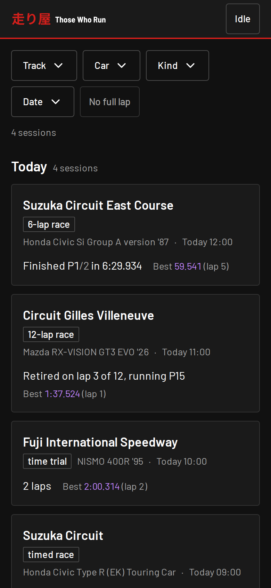
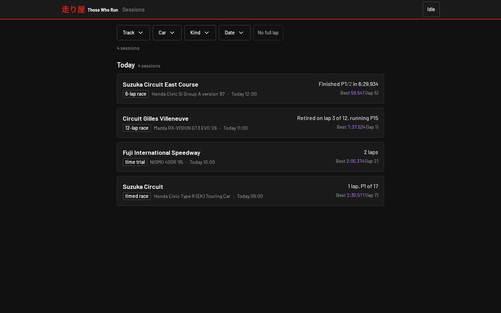
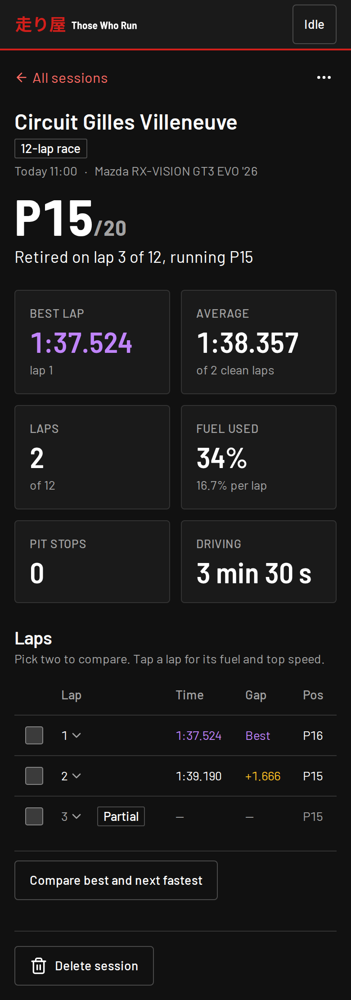
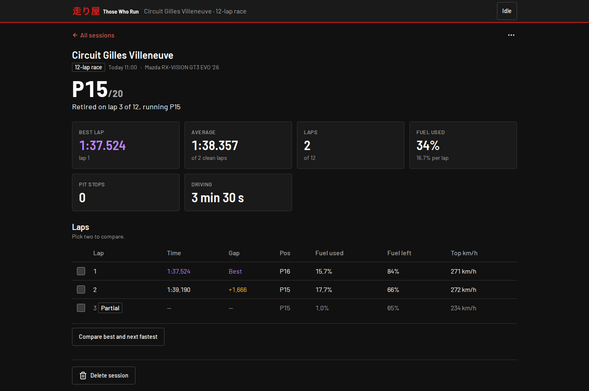
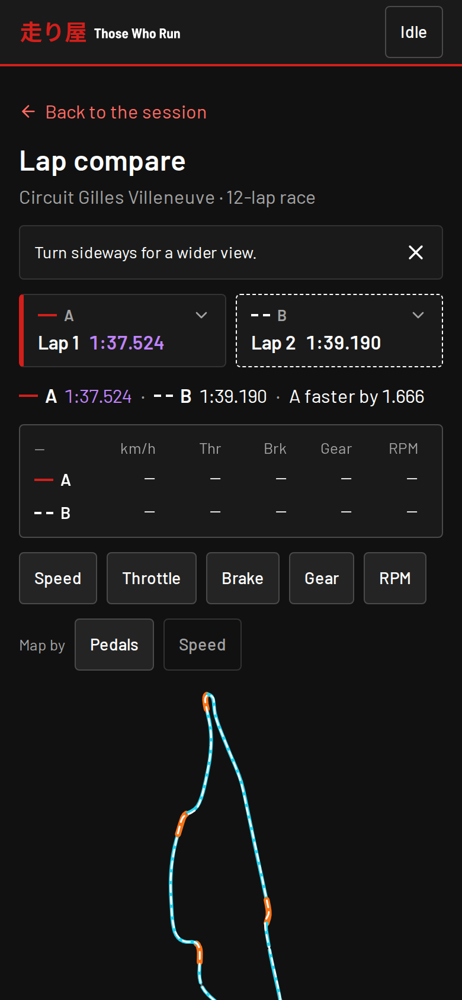
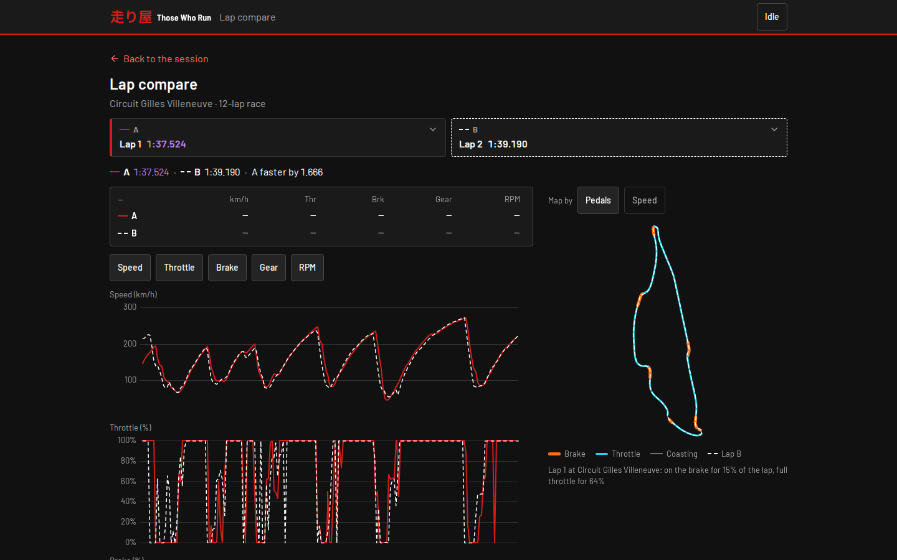
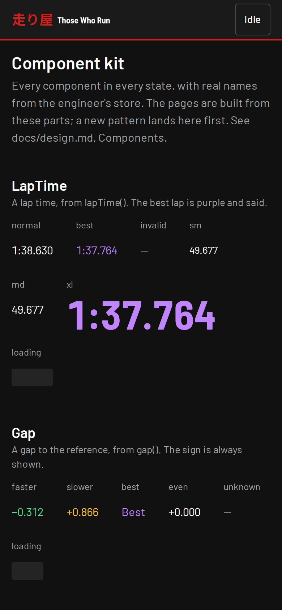
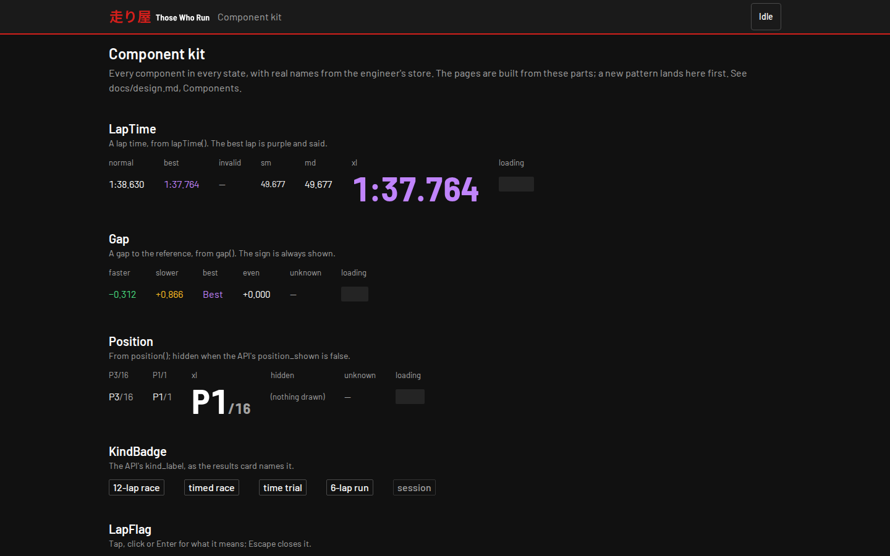

# The pit wall

For the driver and anyone running the pit wall: the pages, the shell, running
it, the data API behind it and the pitwall image. The sessions themselves are
`logbook`'s ([The store](#the-store)). An ADR named here is paddock's
([the records](https://github.com/those-who-run/paddock/tree/main/docs/adr)),
unless it says v1's.

The pit wall is on one address, the deployment overlay's: v2's pit wall took
v1's address, and v1's pit wall is gone (ADR 0012). A results card's old link,
`/?session=<id>`, keeps working there, for v2's sessions and for v1's once
`logbook` has imported them, as they keep v1's ids (ADR 0009), and opens its
session whether it was deleted or not.

## Pages

The pit wall is a React app over `logbook`'s sessions, served with its data
API from one origin by `pitwall` ([Running it](#running-it); one origin is
v1's [ADR 0003](https://github.com/those-who-run/those-who-run/blob/v1.0.0/docs/adr/0003-ui-stack.md),
which paddock's [v1 records](https://github.com/those-who-run/paddock/blob/main/docs/adr/README.md#v1s-records)
keep for v2). One column, so it works on a phone straight after a race:

- **Sessions** (`/`): grouped by day in your browser's time zone, newest first,
  each with its results card (title, result, best lap, car, fuel used). The
  session being driven is pinned at the top with the engineer's lap and
  position, and follows its laps without a reload. Filter by track, car,
  session kind and dates; the filters live in the URL. A session with no full
  lap is tucked away until asked for (`?all=1`).
- **A session** (`/sessions/<id>`): the result first, then stat tiles, the race
  story (lap time and position by lap) and the laps: time, gap to the best lap,
  fuel used and left, position (only in a field GT7 flags, as on the card), top
  speed and flags: **pit** and **out** for the in-lap and out-lap `ecu`'s
  pit-stop detector marked (tyre-only stops included), **restart** for a lap an
  engineer restart fell in, and **partial** for a lap with no full time, such as
  the one the session ended in. GT7 does not report track limits. Pick two laps
  to compare; the picks are in the URL.
- **Lap compare** (`/sessions/<id>/compare?a=&b=`): speed, throttle, brake, gear
  and RPM of two laps over time from each lap's start, from the same session or
  another at the same track, with one cursor across every chart (a horizontal
  drag scrubs on a phone), drag or pinch to zoom, and a double tap to reset. The
  track map shows lap A's line in plan, coloured by the pedals or by speed, with
  lap B dashed over it and both cars at the cursor; a tap on it moves the
  cursor. Comparing by distance instead of time is planned.

| | Phone | Desktop |
|---|---|---|
| Sessions |  |  |
| A session |  |  |
| Lap compare |  |  |
| `/_kit` |  |  |

`/_kit` is the component kit's review page (v1's
[ADR 0004](https://github.com/those-who-run/those-who-run/blob/v1.0.0/docs/adr/0004-design-language.md)),
not a page a driver uses.

The screenshots are made by `make docs-screenshots`
(`web/playwright.docs.config.ts`) over the e2e suite's store, with the
engineer idle and no session open. CI's Docs screenshots workflow runs it, by
hand or on a PR that changes what makes them, and uploads them as the
`docs-screens` artifact: unzip it over `docs/assets/screens/` and commit.

A closed session's page has **Delete**, which asks first, naming the
session's track, car and date. A deleted session is left out of the list and
lap compare, but nothing is removed: its page still opens, says it was
deleted, and has **Restore**, which puts it back (paddock's ADR 0014).

## The shell

Every page sits in the shell (`web/src/app/`): a header with the 走り屋
wordmark and the **live engineer chip**, which asks `GetEngineStatus` every
5 s while the tab is visible and says "Live · Suzuka Circuit · L3", "Paused",
"Replay", "Demo", "Idle" (or "In the menus"), or "Engineer offline" when the
engineer doesn't answer; the pages carry on either way. Tap it for the
engineer's version, telemetry and voice ("Unknown" when `radio` says nothing
of it), a link to the live session, and the pit wall's own version, from
`/healthz`. The engineer and the pit wall are released apart in v2, so their
versions differing is not a warning (those-who-run/paddock#125 R7). The sections' navigation (`web/src/app/sections.ts`) appears once
there are two. **Add to Home Screen** on the iPhone (Safari, Share, Add to Home
Screen) gives the 走り屋 icon and opens the pit wall full screen with no Safari
bars, from `web/public/manifest.webmanifest`; there is no service worker, so a
deploy is never hidden behind a stale cache.

## Running it

`pitwall` (`cmd/pitwall`) is v2's pit wall server, in Go (those-who-run/paddock#124).
It holds no data and mounts no volume: the sessions come from `logbook`, over
NATS, and the engineer's status from the `live` KV bucket. One origin serves
the API, `/healthz` and the built web app (`make web-build`, which needs Node;
see [the web app's guide](../web/README.md)):

```sh
make web-build
TWR_NATS_URL=nats://127.0.0.1:4222 TWR_PITWALL_STATIC_DIR=web/dist go run ./cmd/pitwall   # http://localhost:8080
```

Its NATS needs `logbook` on it for the sessions, and a live `ecu` writing the
`live` bucket for the chip. paddock's compose stack (`deploy/compose`) has
`logbook`, with its NATS on `127.0.0.1:4222`, but no live `ecu`: its one `ecu`
is the one-shot `replay` service, which writes `ecu.status.replay-<run>`, and
the chip reads only the live source's keys, so under compose the chip says
"Engineer offline". It runs this pit wall too: `make pitwall` in
paddock starts the image at http://localhost:9852 (host port 9852 to the
container's 8080, v1's port), on the sessions of `TWR_PITWALL_SRC`,
`replay-compose` by default, which is what its `make replay` stores. Its
`logbook` takes port 8080 on the host, so a pit wall run from this checkout
beside it needs another `ADDR`, such as `ADDR=127.0.0.1:8081`, and
`TWR_PITWALL_SRC=replay-compose` to show the replays. `pitwall -version` prints
the version and exits.

Its configuration, from the environment (the `TWR_*` prefix is the
maintainer's decision D5, 2026-10-31; `ADDR` and `LOG_LEVEL` are every
component's):

| Variable | Default | Purpose |
|---|---|---|
| `ADDR` | `:8080` | Where it listens; paddock's compose publishes the container's 8080 on 9852, v1's port. |
| `LOG_LEVEL` | `info` | `debug` adds an access log line per request: method, path, status and time, never a header or the query. |
| `TWR_NATS_URL` | `nats://127.0.0.1:4222` | The NATS server `logbook` and the `live` bucket are on. NATS down at the start doesn't stop the pit wall: it keeps trying, and serves the web app meanwhile. |
| `TWR_PITWALL_STATIC_DIR` | unset; `/web` in the image | The built web app. Unset serves the API and `/healthz` only. |
| `TWR_PITWALL_SRC` | `live,v1-import` | The sources whose sessions it shows, comma separated, in order of preference: v2's own and v1's imported history (decision D7). A list naming no source is an error, never "every source". |
| `TWR_PITWALL_STALE` | `15s` | How old `ecu`'s live status may be before the chip says "Engineer offline". |

It has no login: keep it on the home network (decision D1, ADR 0011). It
stops within 1 s of SIGTERM, so a rollout never waits on it.

## On the phone and iPad

Open the deployed pit wall. v1's `make web-preview`, which copied v1's store
out of the pit wall's pod and served the copy from a laptop, has no v2
counterpart: v2's pit wall holds no data to copy. To try a build from a laptop
on a phone on the same network, run it as in [Running it](#running-it) with
`ADDR=0.0.0.0:8081` and open the laptop's address on that port; the sessions
and the chip are whatever its NATS has.

## The data API

The API is `twr.pitwall.v1.PitwallService`, a Connect service defined in
`contracts` (contracts#41), at `/twr.pitwall.v1.PitwallService/<Method>`. Its
reads have no side effects, so the web app calls them with GET and the
browser's cache works. Its two writes, `DeleteSession` and `RestoreSession`
(paddock's ADR 0014), are POST only and never cached.

| Method | What it answers | v1's route |
|---|---|---|
| `ListSessions` | Sessions, newest first, filtered by track, car, kind and days in the viewer's zone, with the values each filter can take | `GET /api/v1/sessions` |
| `GetSession` | One session | `GET /api/v1/sessions/{id}` |
| `ListLaps` | Its lap table, flags included (`pit`, `out_lap`, `invalid`, `restart`, `best`, `clean`) | `GET /api/v1/sessions/{id}/laps` |
| `GetTrace` | One lap's speed, throttle, brake, gear, RPM and position against time | `GET /api/v1/sessions/{id}/laps/{lap}/trace` |
| `ListSameTrack` | The other sessions at the same track, for lap compare | `GET /api/v1/sessions/{id}/same-track` |
| `GetEngineStatus` | What the engineer is doing now, for the live chip | `GET /api/engine/status` |
| `DeleteSession` (POST) | Deletes a closed session, softly: `logbook` keeps its rows and lap files, the list and lap compare leave it out, and its page still opens, with `deleted_at` set | none |
| `RestoreSession` (POST) | Brings a deleted session back | none |
| `GET /healthz` (plain HTTP) | `ok`, `version`, and whether `nats` and `logbook` answered | `GET /healthz` |

There is no `/metrics` yet: those-who-run/paddock#126 adds it.

- **From `logbook`.** Each data method asks `logbook`'s micro endpoints
  (`svc.logbook.*`, `twr.store.v1`) for the sources in `TWR_PITWALL_SRC`, and
  maps the answer (decision D6): `logbook` keeps `ecu`'s summary and laps as
  `ecu` published them, and the pit wall works out the names, flags and labels
  the page shows (`internal/api/map.go`): the track's name as the card names it
  (the layout when the detector is sure, else the circuit, else "Unknown
  track"), which the track filter takes too, the lap flags from `ecu`'s pit roles, `ecu`'s best lap, the
  restart laps from the session's gaps, the position only in a field GT7 flags.
- **The card's words.** A session's `title`, `result` and `kind_label` are the
  results card's, from `contracts`' `format` package (`Title`, `Result`,
  `KindLabel`), which `podium`'s card calls too, so the page and the card never
  name a session differently. The track's name and `position_shown` come from
  the same package.
- **ETags.** Every data answer carries a weak `ETag` holding `logbook`'s
  `data_version` and `Cache-Control: no-cache`. A GET with that ETag in
  `If-None-Match` passes the version to `logbook` as `known_data_version`, which
  answers `unchanged` at next to no cost, and the pit wall answers 304 with no
  body. Answers over 1 KB are gzipped when the browser takes it.
- **Errors** are Connect's: a session or lap that isn't there is `not_found`, a
  bad argument `invalid_argument`, deleting an open session
  `failed_precondition`, and `logbook` not answering within 2 s
  `unavailable`. The web app is served all the same.
- **Deleting and restoring** ask `logbook`'s `svc.logbook.sessions.delete` and
  `.restore`. Each changes `logbook`'s `data_version` (a repeat changes
  nothing), so every read's ETag changes and the list drops or shows the
  session again. The answer carries `Cache-Control: no-store` and no ETag.
  There is no login (ADR 0011). The writes take only a JSON or protobuf body
  by POST: a form or `text/plain` body is 415, a GET 405, and a JSON body from
  another origin needs a CORS preflight, which the pit wall answers with no
  allow headers (`internal/service/crosssite_test.go`). That stops an ordinary
  cross-site page, but not all of them: a DNS-rebinding page is same-origin
  as far as the browser knows, needs no preflight, and isn't stopped. ADR 0014
  (point 8) accepts that risk, because a delete can be restored.
- **The engineer's status** comes from a watch on `ecu.status.live`,
  `ecu.session.live` and `radio.status.live` in the `live` bucket, kept open for
  the server's life (those-who-run/paddock#125). Only the `live` source's keys
  are read, so a replay never shows. With no value, a value older than
  `TWR_PITWALL_STALE` or NATS down it answers `ACTIVITY_OFFLINE`, never an
  error, and it is never cached (`no-store`). `voice_connected` is absent when
  `radio` says nothing of it.
- **`/healthz`** is 200 whether or not NATS and `logbook` answer, and 503 only
  when `TWR_PITWALL_STATIC_DIR` is set and its `index.html` can't be read.
- **The web app** is served from `TWR_PITWALL_STATIC_DIR` on every other path,
  with `index.html` for client routes such as `/sessions/<id>`, `/_kit` and
  v1's results-card link `/?session=<id>` (permanent: ADR 0009 and 0012).
  Hashed files under `assets/` are cached for a year, and a missing one is a
  404; `index.html` is never cached.

## The store

The pit wall has none, and mounts no volume. Every session, lap and frame is
`logbook`'s, the only reader and writer of its data volume (ADR 0003 and
0007); the pit wall reads them through `logbook`'s services
([The data API](#the-data-api)). [`logbook`'s README](https://github.com/those-who-run/logbook#the-store)
describes the store. v1's store (its SQLite index, lap files and writer lock)
stays with v1, and its history reaches the pit wall through `logbook`'s
import (ADR 0009).

## The pitwall image

`ghcr.io/those-who-run/twr-pitwall:X.Y.Z` is the pit wall's image
(those-who-run/paddock#131; images on ghcr, paddock ADR 0006). The
`Dockerfile` builds the web app in Node's image (the version in
`web/.node-version`, with `npm ci` and `npm run build`), the server in Go's
(`CGO_ENABLED=0`, its version built in with `-ldflags` from the release tag),
and runs both from distroless's static image as its non-root user (65532):
the binary at `/service` and `web/dist` at `/web`, with
`TWR_PITWALL_STATIC_DIR=/web` set, on port 8080. It has no Node, no Python
and no shell. A deployment probes `GET /healthz`, which is 503 when `/web`'s
`index.html` can't be read.

Every PR builds it and runs `scripts/image_smoke.sh` on it, pushing nothing:
the version, the non-root user, under 40 MB, no Node or Python, `/healthz`
answering 200 with the version within 10 s, `index.html` on `/`, on a
session's page and on v1's card link `/?session=<id>`, and `GetEngineStatus`
answering offline over Connect's GET. A
release tag `vX.Y.Z` builds it again, runs the same smoke test expecting
`X.Y.Z`, and `image-publish.yml` in `those-who-run/.github` pushes that build
with its SBOM and provenance, attested. Check an image with:

```sh
gh attestation verify oci://ghcr.io/those-who-run/twr-pitwall:X.Y.Z -R those-who-run/pitwall \
  --signer-workflow those-who-run/.github/.github/workflows/image-publish.yml
```
